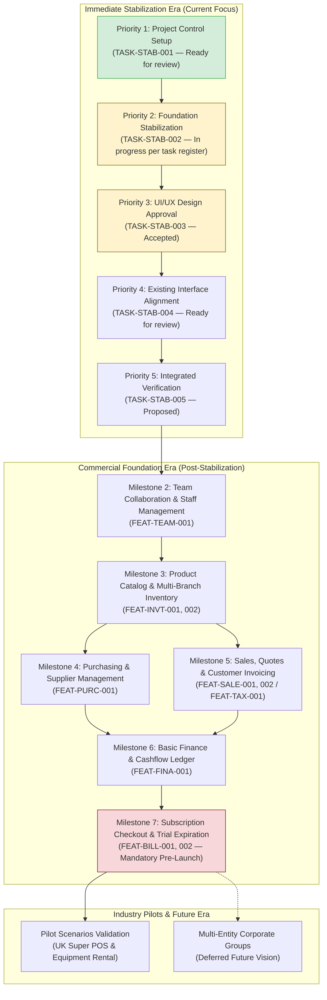

# STACK37 EOS — Development Roadmap

**Product:** STACK37 EOS / My Business by STACK37  
**Governance:** Chief Executive Officer, STACK37 (Pvt) Ltd  
**Planning Principle:** Strict milestone dependency ordering. No speculative development dates.  

---

## 1. Roadmap Architecture & Priority Phases

The comprehensive **STACK37 EOS Development Master Roadmap** spans **138 tracked capabilities** covering the long-term enterprise vision. The authoritative master blueprint is archived and version-controlled at [docs/references/STACK37_EOS_Development_Master_Roadmap_v1.pdf](file:///c:/Users/nimth/Desktop/Developments/stack37-eos/docs/references/STACK37_EOS_Development_Master_Roadmap_v1.pdf).

To ensure rigorous execution and prevent technical debt, development proceeds strictly through the following authorized sequential phases. Milestone summaries below provide executive readability while preserving full traceability to the long-term master scope:

---

## 2. Milestone Details & Customer Capabilities

### Priority 1: Project Control Setup *(ACTIVE — TASK-STAB-001)*
* **Owner:** Google Antigravity (Backend Owner)
* **Scope:** Institute permanent cross-agent documentation (`AGENTS.md`, `PROJECT_STATE.md`, `docs/*`), responsibility policy, and evidence framework.

### Priority 2: Foundation Stabilization *(PROPOSED — TASK-STAB-002)*
* **Owner:** Google Antigravity (Backend Owner)
* **Scope:** Reconcile Phase 3C.3 uncommitted files, verify remote migrations 11 & 12, run complete test regression suites, and perform CEO-authorized Git commit.

### Priority 3: UI/UX Design Approval *(ACCEPTED — TASK-STAB-003)*
* **Owner:** ChatGPT Codex (Frontend/UI Owner) & CEO
* **Scope:** Review and approve corporate visual identity, official STACK37 logo, navy typography, blue/violet palette, layout navigation, and eliminate placeholder elements.

### Priority 4: Existing Interface Alignment *(READY FOR REVIEW — TASK-STAB-004)*
* **Owner:** ChatGPT Codex (Frontend/UI Owner)
* **Scope:** Align existing authentication, layout, dashboard, and settings screens to the approved UI/UX design.

### Priority 5: Integrated Verification *(PROPOSED — TASK-STAB-005)*
* **Owner:** Joint (Google Antigravity + ChatGPT Codex)
* **Scope:** Joint end-to-end regression audit across backend RPCs, security, and aligned UI interfaces.

---

### Milestone 2: Team Collaboration & Staff Management *(PLANNED LAUNCH SCOPE)*
* **Status:** Confirmed Launch Requirement (Requires completion of Priorities 1–5)
* **What Customers Can Do After Completion:**
  * Business Owner or Administrator invites team members via email.
  * Assigns roles: `Administrator` (manage staff, view audit) or `Member` (operational staff).
  * Assigns staff to specific operating branches (Headquarters or future secondary branch).
  * Invited members accept invitation, set credentials, and enter workspace.
  * Owner can view active team roster and revoke access immediately.

---

### Milestone 3: Product Catalog & Multi-Branch Inventory *(CONFIRMED LAUNCH SCOPE)*
* **Status:** Confirmed Launch Requirement
* **What Customers Can Do After Completion:**
  * Maintain master catalog of products and services (Name, SKU, Barcode, UOM).
  * Set cost price, standard selling price, and tax classification.
  * Track real-time inventory balances independently per operating branch.
  * Record manual stock adjustments (damage, shrinkage, stock-in) with mandatory audit reasons.
  * Execute inter-branch stock transfers (HQ -> Branch).

---

### Milestone 4: Purchasing & Supplier Management *(CONFIRMED LAUNCH SCOPE)*
* **Status:** Confirmed Launch Requirement
* **What Customers Can Do After Completion:**
  * Maintain supplier records (Name, BRN, contact person, payment terms).
  * Create Purchase Orders (POs) for inventory replenishment.
  * Receive stock shipments via Goods Received Notes (GRNs) directly updating branch stock.
  * Track unpaid supplier bills and accounts payable.

---

### Milestone 5: Sales, Quotations & Customer Invoicing *(CONFIRMED LAUNCH SCOPE)*
* **Status:** Confirmed Launch Requirement (Requires Independent Tax Settings `FEAT-TAX-001`)
* **What Customers Can Do After Completion:**
  * Maintain customer directory (Name, TIN, billing address, credit terms).
  * Issue price quotations; convert accepted quotes to Sales Invoices.
  * Issue commercial Sales Invoices with automated, statutory calculations:
    * Subtotal and line-item discounts
    * VAT (calculated only if organization is VAT-registered and item is taxable)
    * SSCL (calculated only if organization is SSCL-registered)
    * Total payable
  * Deduct stock atomically from the issuing branch upon invoice finalization.
  * Generate printable, downloadable tax invoices.

---

### Milestone 6: Basic Finance & Cashflow Ledger *(CONFIRMED LAUNCH SCOPE)*
* **Status:** Confirmed Launch Requirement
* **What Customers Can Do After Completion:**
  * Maintain Cash and Bank ledgers (Petty Cash, Main Bank Account).
  * Record customer payments against invoices.
  * Record supplier payments against purchase bills.
  * Monitor real-time Accounts Receivable (AR) and Accounts Payable (AP) aging.
  * View executive cashflow snapshot: daily revenue, cash collected, net position.

---

### Milestone 7: Subscription Checkout & Trial Expiration Handling *(MANDATORY PRE-LAUNCH)*
* **Status:** Mandatory Pre-Launch Requirement (Must be completed BEFORE paid public launch)
* **What Customers Can Do After Completion:**
  * Self-service upgrade from 7-day trial to paid subscription.
  * Checkout securely via international cards (Lemon Squeezy) or local Sri Lankan payment mechanisms.
  * Workspaces approaching trial expiration receive clear notifications; expired workspaces transition to a read-only state until payment is rendered.

---

### Milestone 8: Industry Pilot Validation Scenarios *(PROPOSED PILOTS)*
* **Status:** Proposed Pilot Configurations (Requirement validation only)
* **8A — Retail & Supermarket POS (UK Super Pilot):** Fast barcode scanning, touchscreen layout, cash drawer trigger, receipt printing.
* **8B — Equipment Rental Pilot:** Serialized machinery hire, duration contracts, security deposit ledger, return inspection checklists.
* **Governance Rule:** Implemented as configurable options on the single core platform; never as separate codebases.

---

### Milestone 9: Multi-Entity Corporate Groups *(DOCUMENTED FUTURE VISION)*
* **Status:** Future Vision (Deferred beyond initial commercial release)
* **Scope:** Managing multiple distinct legal corporations under one consolidated group holding account.
