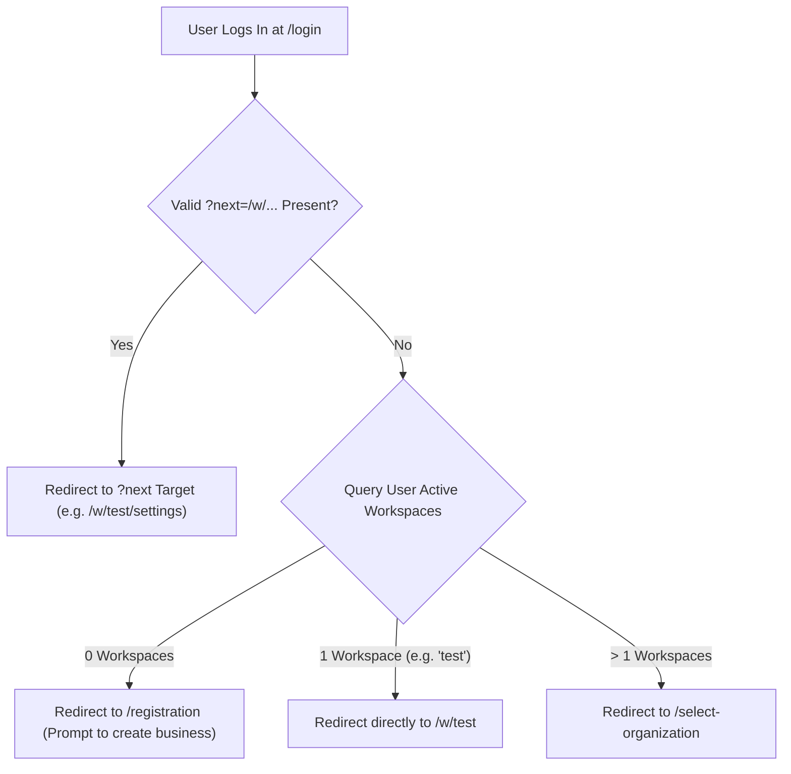

# STACK37 EOS — Revised Production Tenant-Routing Contract Specification
## Collision-Safe `/w/[tenantSlug]/...` Architecture & Security Verification

**Document Path:** `docs/integration/TASK-TENANT-ROUTING-CONTRACT.md`<br />
**Author:** Google Antigravity (Backend Engineering & System Architecture Owner)<br />
**Target Audience:** Chief Executive Officer, ChatGPT Codex (Frontend/UI Owner), ChatGPT (Product Coordination)<br />
**Task ID:** `TASK-TENANT-ROUTING-001`<br />
**Revision:** 2.1 (Implemented & Verified Specification — Local Supabase Verified)<br />
**Status:** **CEO-ACCEPTED FOR LOCAL ROUTING SCOPE ONLY — PRODUCTION AUTHORIZATION PENDING**<br />
**Target Host:** `https://mybusiness.stack37.com`

---

## 1. Executive Summary & Why `/w/[tenantSlug]/...` Is Collision-Safe

In multi-tenant SaaS architecture, hosting tenant workspaces directly at the root path (e.g. `/:tenantSlug`) creates severe namespace collision vulnerabilities:
- If an organization registers with the slug `settings`, `pricing`, `billing`, `api`, `support`, `legal`, `help`, or `docs`, their slug conflicts with current or future top-level marketing, documentation, or account settings pages.
- Dynamic route resolution at the root path requires complex exclusions and risks breaking as new platform pages are introduced.

### The Collision-Safe Namespace Contract:
By partitioning all tenant workspaces behind the dedicated `/w/` prefix, the platform achieves:
1. **Total Namespace Independence:** Any valid business slug (e.g. `test`, `acme`, `supermarket`) operates inside `/w/[tenantSlug]/` without ever colliding with top-level platform routes.
2. **Deterministic Edge Precedence:** Next.js Edge Middleware (`src/proxy.ts`) instantly distinguishes workspace traffic from marketing or shared system routes by inspecting the leading path segment.
3. **Host-Only Cookie Continuity:** User sessions established at `https://mybusiness.stack37.com/login` are seamlessly preserved across all `/w/:tenantSlug` routes using secure, host-only cookies (`domain: undefined`), eliminating cross-subdomain cookie leakage and third-party cookie blocking.

---

## 2. Canonical Workspace URLs & Examples

For an organization named **"Test"** with slug **`test`**:

| Purpose | Canonical Production URL | Local Development URL | Internal Route Handler |
| :--- | :--- | :--- | :--- |
| **Workspace Overview / Dashboard** | **`https://mybusiness.stack37.com/w/test`** | `http://mybusiness.localhost:3000/w/test` | `src/app/tenant/[tenantSlug]/page.tsx` |
| **Business Settings** | **`https://mybusiness.stack37.com/w/test/settings`** | `http://mybusiness.localhost:3000/w/test/settings` | `src/app/tenant/[tenantSlug]/settings/page.tsx` |
| **Future Point of Sale (POS)** | `https://mybusiness.stack37.com/w/test/pos` | `http://mybusiness.localhost:3000/w/test/pos` | `src/app/tenant/[tenantSlug]/pos/page.tsx` |
| **Future Inventory Management** | `https://mybusiness.stack37.com/w/test/inventory` | `http://mybusiness.localhost:3000/w/test/inventory` | `src/app/tenant/[tenantSlug]/inventory/page.tsx` |

*Trailing Slash Invariant:* Both `https://mybusiness.stack37.com/w/test` and `https://mybusiness.stack37.com/w/test/` resolve to the workspace overview without extraneous redirects.

---

## 3. Route Precedence in Edge Proxy (`src/proxy.ts`)

Every incoming HTTP request will be evaluated in the following strict sequential precedence order:

```
Incoming Request
  │
  ├── 1. Static Assets & Next.js Internals (/_next/*, /favicon.ico, *.*) ──► Allow (NextResponse.next)
  │
  ├── 2. Direct Internal Tenant Directory Access (/tenant/*) ────────────► 404 Not Found (Blocked)
  │
  ├── 3. Header Sanitization (Strip client 'x-tenant-slug') ─────────────► Clean request headers
  │
  ├── 4. Host Domain Classification:
  │     ├── Apex & Marketing (stack37.com, www.stack37.com) ──────────────► Blocked from auth
  │     ├── Reserved Subdomains (admin, api, app, auth, billing, support) ─► 404 Not Found
  │     ├── Legacy Tenant Subdomains (*.stack37.com) ────────────────────► Safe Forwarding (Section 6)
  │     └── Central Portal Host (mybusiness.stack37.com) ────────────────► Proceed to Step 5
  │
  └── 5. Central Portal Path Matching (mybusiness.stack37.com):
        ├── 5a. Root (/ or empty) ────────────────────────────────────────► 307 Redirect to /login
        ├── 5b. Shared System & Auth Routes (/login, /register, etc.) ────► Direct Route Handler
        ├── 5c. Collision-Safe Workspace Routes (/w/:tenantSlug/*) ───────► Internal Rewrite to /tenant/:tenantSlug/*
        └── 5d. Unmatched Top-Level Path ────────────────────────────────► 404 Not Found
```

### Edge Proxy Route Precedence Table

| Precedence | Route Category | Condition / Match | Action in Edge Proxy | Security / Architectural Invariant |
| :---: | :--- | :--- | :--- | :--- |
| **P1** | **Static Assets** | `url.pathname.startsWith('/_next')` \|\| `includes('.')` | `NextResponse.next()` | Never intercept CSS, JS, or images. |
| **P2** | **Internal Directory Protection** | `url.pathname.startsWith('/tenant')` | `new NextResponse('Not Found', { status: 404 })` | Prevents public inspection of internal App Router structure. |
| **P3** | **Header Sanitization** | All requests | `request.headers.delete('x-tenant-slug')` | Neutralizes client-side tenant identity spoofing. |
| **P4** | **Host Classification** | Host is `admin`, `api`, `app`, `auth`, `www`, or apex `stack37.com` | `new NextResponse('Not Found', { status: 404 })` | Isolates SaaS portal from marketing and external systems. |
| **P5-a** | **Portal Root** | `host === 'mybusiness'` && `(pathname === '/' || pathname === '')` | `NextResponse.redirect('/login')` (307) | Central entry point policy; preserves query parameters. |
| **P5-b** | **Shared System Routes** | `host === 'mybusiness'` && `pathname in SHARED_AUTH_PREFIXES` | `targetUrl = url` (Rewrite to root) | Direct execution of login, registration, recovery, and callbacks. |
| **P5-c** | **Workspace Prefix** | `host === 'mybusiness'` && `pathname.startsWith('/w/')` | `url.pathname = /tenant/${slug}${subpath}` | Internal rewrite to workspace components. Validates slug format. |
| **P5-d** | **Unmatched Path** | `host === 'mybusiness'` && non-reserved path not under `/w/` | `new NextResponse('Not Found', { status: 404 })` | Fails closed on unrecognized routes. |
| **P6** | **Legacy Subdomain** | `host.endsWith('.stack37.com')` && `subdomain !== 'mybusiness'` | Safe Forwarding (Sanitized Redirect) | See Section 6 for token stripping rules. |

---

## 4. Reserved Paths and Slugs

### A. Reserved Top-Level System Paths (under `mybusiness.stack37.com`)
The following top-level path segments are permanently reserved for system infrastructure and authentication:

```typescript
export const RESERVED_TOP_LEVEL_PATHS = new Set([
  // Authentication & Identity
  'login',
  'register',
  'forgot-password',
  'reset-password',
  'verify-email',
  'auth',

  // Workspace Directory & Onboarding Wizard
  'select-organization',
  'registration',

  // Workspace Namespace Prefix
  'w',

  // Internal Directories (Blocked)
  'tenant',
  'api',
  '_next',

  // Static Technical Assets
  'favicon.ico',
  'robots.txt',
  'sitemap.xml',
]);
```

### B. Reserved Organization Slugs (`RESERVED_SLUGS`)
Defined in [`src/lib/validations/organization.ts`](file:///c:/Users/nimth/Desktop/Developments/stack37-eos/src/lib/validations/organization.ts) and backed by database check constraints in Migration 02 (`20261010000002_02_core_tenancy.sql`):

```typescript
export const RESERVED_SLUGS = new Set([
  // Database CHECK Constraint Reserved
  'admin',
  'api',
  'app',
  'auth',
  'billing',
  'support',
  'www',
  'mybusiness',

  // Platform & Environment Protection
  'portal',
  'status',
  'mail',
  'staging',
  'dev',

  // Routing Namespace Protection
  'w',
  'workspace',
  'settings',
  'tenant',
  'dashboard',
]);
```

*Slug Formatting Constraint:* Slugs must adhere to `SLUG_REGEX = /^[a-z0-9](-?[a-z0-9]){1,61}[a-z0-9]$/` (3–63 characters, lowercase alphanumeric with non-consecutive hyphens).

---

## 5. Safe Login Return Paths (`?next=...`) & Flow Resolution

### A. Deep-Link Interception Flow
1. An unauthenticated user navigates to `https://mybusiness.stack37.com/w/test/settings`.
2. `requireTenantAccess('test', '/w/test/settings')` verifies the Supabase session via `supabase.auth.getUser()`.
3. Finding no active session, it redirects to:
   $$\text{https://mybusiness.stack37.com/login?next=} + \text{encodeURIComponent('/w/test/settings')}$$
4. The user completes authentication at `https://mybusiness.stack37.com/login`.

### B. Anti-Open-Redirect Defense (`sanitizeRedirectPath`)
The return path is sanitized by [`src/lib/validations/auth.ts`](file:///c:/Users/nimth/Desktop/Developments/stack37-eos/src/lib/validations/auth.ts):
- **Relative Path Requirement:** Must start with a single `/`.
- **Protocol-Relative Rejection:** Paths starting with `//` (e.g. `//attacker.com`) are rejected.
- **Backslash Injection Rejection:** Paths containing `\` (e.g. `/\attacker.com` or `\dashboard`) are rejected.
- **Control Character Rejection:** Paths containing `\r`, `\n`, or `\0` (HTTP response splitting vectors) are rejected.
- **Whitelist Character Match:** Only safe URL characters `^[a-zA-Z0-9_\-\.\/\?=&%#+]*$` are permitted.
- **Namespace Whitelisting:** The return path must begin with `/w/`, `/select-organization`, or `/registration`. Any arbitrary or unrecognized path safely falls back to `/select-organization`.

### C. Post-Login Destination Resolution



---

## 6. Safe Handling of Legacy `*.stack37.com` URLs (Token Leakage Defense)

### A. The Vulnerability: Blind Forwarding of Sensitive Tokens
If a user or external email client clicks a link targeting a legacy subdomain, such as:
`https://test.stack37.com/auth/callback?code=SECRET_PKCE_CODE` or<br />
`https://test.stack37.com/auth/confirm?token_hash=RECOVERY_HASH&type=recovery`

**Blindly forwarding query parameters in a 308 redirect creates catastrophic security risks:**
1. **Token Exposure Across Origins:** Sensitive one-time tokens would be broadcast in HTTP Location headers and recorded in proxy and server access logs.
2. **Referrer Leakage:** Downstream browser requests could leak unconsumed recovery hashes in HTTP `Referer` headers.
3. **Open Redirect Phishing:** Attackers could abuse legacy subdomains to bounce authenticated users with forged token hashes.

### B. Strict Sanitization & Redirect Policy for Legacy Subdomains

```typescript
// Implemented Legacy Subdomain Handling in src/proxy.ts
if (subdomain !== 'mybusiness') {
  // 6a. Auth callback/confirm endpoints: redirect to portal login with error, NEVER echoing credentials
  if (url.pathname.startsWith('/auth')) {
    const redirectUrl = new URL('/login?error=auth_callback_host_mismatch', canonicalPortalOrigin);
    return NextResponse.redirect(redirectUrl, 307);
  }

  // 6b. Direct login requests on legacy subdomain: redirect to central login with safe return path
  if (url.pathname === '/login') {
    const redirectUrl = new URL(`/login?next=/w/${subdomain}`, canonicalPortalOrigin);
    return NextResponse.redirect(redirectUrl, 308);
  }

  // 6c. Shared auth/system routes on legacy subdomain: redirect to canonical portal route
  const isSharedAuthRoute = SHARED_AUTH_PREFIXES.some(
    (prefix) => url.pathname === prefix || url.pathname.startsWith(`${prefix}/`)
  );
  if (isSharedAuthRoute) {
    const redirectUrl = new URL(url.pathname, canonicalPortalOrigin);
    return NextResponse.redirect(redirectUrl, 308);
  }

  // 6d. Navigational workspace paths: 308 redirect to /w/:subdomain/* with sensitive tokens stripped
  const targetPath = `/w/${subdomain}${url.pathname === '/' ? '' : url.pathname}`;
  const redirectUrl = new URL(targetPath, canonicalPortalOrigin);

  url.searchParams.forEach((val, key) => {
    if (!SENSITIVE_QUERY_PARAMS.has(key.toLowerCase())) {
      redirectUrl.searchParams.set(key, val);
    }
  });

  return NextResponse.redirect(redirectUrl, 308);
}
```

---

## 7. Multi-Layer Tenant Authorization Architecture & Test Citations

Every security claim in this routing contract is verified by automated regression test suites:

```
┌────────────────────────────────────────────────────────┐
│ Layer 1: Edge Proxy (src/proxy.ts)                     │
│ - Strips client-injected 'x-tenant-slug'               │
│ - Blocks direct access to internal '/tenant/*' routes │
│ - Enforces collision-safe '/w/:tenantSlug' rewrite     │
└───────────────────────────┬────────────────────────────┘
                            │
                            ▼
┌────────────────────────────────────────────────────────┐
│ Layer 2: Server Guard (src/lib/auth/tenant-guard.ts)   │
│ - Cryptographically verifies JWT via getUser()         │
│ - Validates user membership in organization_members    │
│ - Blocks suspended staff ('suspended' -> AccessDenied) │
│ - Blocks non-members ('not_a_member' -> AccessDenied)  │
└───────────────────────────┬────────────────────────────┘
                            │
                            ▼
┌────────────────────────────────────────────────────────┐
│ Layer 3: Database PostgreSQL Row Level Security (RLS)  │
│ - Tables enforce: organization_id IN get_user_orgs()   │
│ - Prevents cross-tenant leaks even if code is flawed   │
└────────────────────────────────────────────────────────┘
```

### Comprehensive Security Claim & Automated Test Evidence Table

| Security Invariant / Claim | Implementation Mechanism | Test File & Specific Test Citations |
| :--- | :--- | :--- |
| **1. Unauthenticated Login Interception** | `requireTenantAccess` redirects missing/expired sessions to `/login?next=...` | [`tests/unit/tenant-guard.test.ts`](file:///c:/Users/nimth/Desktop/Developments/stack37-eos/tests/unit/tenant-guard.test.ts#L29-L40):<br>• `"returns unauthenticated with sanitized login redirect when user session is missing"` |
| **2. Anti-Open-Redirect Defense** | `sanitizeRedirectPath` rejects `//`, `\`, control chars, and non-whitelisted characters | [`tests/unit/auth-validation.test.ts`](file:///c:/Users/nimth/Desktop/Developments/stack37-eos/tests/unit/auth-validation.test.ts#L133-L167):<br>• `"discards protocol-relative URLs"`<br>• `"discards absolute external URLs"`<br>• `"discards backslash injection attacks"`<br>• `"discards paths containing newline or carriage return escapes"`<br>[`tests/unit/tenant-guard.test.ts`](file:///c:/Users/nimth/Desktop/Developments/stack37-eos/tests/unit/tenant-guard.test.ts#L42-L51):<br>• `"sanitizes open-redirect attempts in unauthenticated return path"` |
| **3. Suspended Employee Exclusion** | `membership.status !== 'active'` returns `reason='suspended'` and renders in-app `TenantAccessDenied` UI (HTTP 200 application denial; workspace data suppressed) | [`tests/unit/tenant-guard.test.ts`](file:///c:/Users/nimth/Desktop/Developments/stack37-eos/tests/unit/tenant-guard.test.ts#L77-L123):<br>• `"strictly prevents suspended employees from entering workspace"`<br>[`tests/unit/backend-security-safeguards.test.ts`](file:///c:/Users/nimth/Desktop/Developments/stack37-eos/tests/unit/backend-security-safeguards.test.ts#L505):<br>• `"strictly returns reason='suspended' in verifyTenantAccess for suspended staff"` |
| **4. Non-Member Tenant Isolation** | Organizations hidden or filtered by RLS return `reason='not_a_member'` and render in-app `TenantAccessDenied` UI (HTTP 200 application denial; workspace data suppressed) | [`tests/unit/tenant-guard.test.ts`](file:///c:/Users/nimth/Desktop/Developments/stack37-eos/tests/unit/tenant-guard.test.ts#L53-L75):<br>• `"returns not_a_member when organization does not exist or RLS hides it"` |
| **5. Cross-Tenant Mutation Prevention** | Server actions verify caller ownership against target organization ID | [`tests/unit/backend-security-safeguards.test.ts`](file:///c:/Users/nimth/Desktop/Developments/stack37-eos/tests/unit/backend-security-safeguards.test.ts#L82-L140):<br>• `"strictly rejects updateBusinessConfigurationAction when a user from Org A targets Org B"`<br>• `"strictly rejects updateBranchConfigurationAction when a user from Org A targets a branch in Org B"` |
| **6. Fail-Closed Resolver Permissions** | Settings resolver defaults `canEdit=false` if membership is missing or mismatched | [`tests/unit/backend-security-safeguards.test.ts`](file:///c:/Users/nimth/Desktop/Developments/stack37-eos/tests/unit/backend-security-safeguards.test.ts#L147-L238):<br>• `"resolves canEdit=false when getBusinessConfiguration is accessed with a foreign membership"`<br>• `"resolves canEdit=false when getBusinessConfiguration is called without userMembershipId"` |
| **7. Sole Primary Ownership Invariant** | Exactly one active Primary Owner per organization enforced by database constraints | [`tests/unit/backend-security-safeguards.test.ts`](file:///c:/Users/nimth/Desktop/Developments/stack37-eos/tests/unit/backend-security-safeguards.test.ts#L337-L393):<br>• `"resolves canEdit=true when caller is verified active Primary Owner belonging to requested organization"`<br>• `"blocks administrators who are not Primary Owner from updating Business Settings"` |
| **8. Client Tenant Header Neutralization** | Edge Proxy deletes client-supplied `x-tenant-slug` header on every request | [`tests/unit/proxy-routing.test.ts`](file:///c:/Users/nimth/Desktop/Developments/stack37-eos/tests/unit/proxy-routing.test.ts#L114-L125):<br>• `"sanitizes client-supplied x-tenant-slug header to prevent spoofing"`<br>[`tests/unit/backend-security-safeguards.test.ts`](file:///c:/Users/nimth/Desktop/Developments/stack37-eos/tests/unit/backend-security-safeguards.test.ts#L648-L659):<br>• `"strips client-injected x-tenant-slug header to prevent identity forgery"` |
| **9. Internal Route Protection** | External requests to `/tenant/*` return 404 | [`tests/unit/proxy-routing.test.ts`](file:///c:/Users/nimth/Desktop/Developments/stack37-eos/tests/unit/proxy-routing.test.ts#L67-L73):<br>• `"blocks direct access to internal /tenant routes with 404"`<br>[`tests/unit/backend-security-safeguards.test.ts`](file:///c:/Users/nimth/Desktop/Developments/stack37-eos/tests/unit/backend-security-safeguards.test.ts#L628-L635):<br>• `"strictly returns 404 for direct access to internal /tenant routes"` |
| **10. Central Portal Root Redirection** | Visiting `mybusiness.stack37.com/` returns 307 redirect to `/login` | [`tests/unit/proxy-routing.test.ts`](file:///c:/Users/nimth/Desktop/Developments/stack37-eos/tests/unit/proxy-routing.test.ts#L12-L39):<br>• `"redirects central mybusiness portal root to /login"`<br>• `"redirects central mybusiness portal root in production to /login"`<br>• `"preserves query parameters when redirecting central portal root to /login"` |
| **11. Cryptographic Recovery Token Guard** | Password reset requires 15-min `sb-recovery-token` cookie from verified OTP | [`tests/unit/recovery-auth.test.ts`](file:///c:/Users/nimth/Desktop/Developments/stack37-eos/tests/unit/recovery-auth.test.ts#L1-L60):<br>• `"generates a valid, verifiable recovery token bound to a specific user"`<br>• `"rejects tokens used by a different user than the bound target"`<br>• `"rejects tampered tokens"`<br>[`tests/unit/auth-actions.test.ts`](file:///c:/Users/nimth/Desktop/Developments/stack37-eos/tests/unit/auth-actions.test.ts#L389-L421):<br>• `"does not grant recovery authorization for ordinary PKCE login callbacks"`<br>• `"sets cryptographic sb-recovery-token cookie when processing genuine verified recovery flow"` |
| **12. Database PostgreSQL RLS Isolation** | PostgreSQL policies enforce tenant isolation at SQL engine level | [`tests/db/tenant-isolation.test.ts`](file:///c:/Users/nimth/Desktop/Developments/stack37-eos/tests/db/tenant-isolation.test.ts#L55-L250):<br>• Full multi-tenant isolation suite verifying Org A and Org B cross-table privacy |

### B. In-App Access Denial Behavior & HTTP Status (HTTP 200 vs Protocol 403)

For authenticated users accessing unauthorized or suspended tenant workspaces, the application enforces access denial at the App Router Server Component boundary:
1. **Application Denial Screen (HTTP 200):** When an authenticated session fails tenant authorization (`reason='not_a_member'` or `reason='suspended'`), `src/app/tenant/[tenantSlug]/layout.tsx` catches the failure and renders the branded `TenantAccessDenied` component. Because Next.js Server Components stream an in-app HTML view rather than throwing a low-level protocol exception, the HTTP status is `200 OK` (with `Cache-Control: no-cache, must-revalidate`).
2. **User Experience & Recovery Invariants:** The current in-app denial view displays the signed-in identity (`userEmail`), explains why access was denied (suspension vs missing invite), and provides paths to `/select-organization` and sign out. Next.js also supports a customized HTTP 403 page through experimental `authInterrupts` and `forbidden.tsx`; that is a separate implementation choice and is not used here.
3. **Absolute Data Privacy:** In all denial cases, `TenantLayout` halts evaluation of `props.children`. Zero workspace components, overview data, settings, branches, or customer records are ever rendered or streamed to unauthorized callers.

---

## 8. Codex (Frontend) Implementation Scope & Status

ChatGPT Codex has completed the frontend alignment to the `/w/[tenantSlug]` architecture:

1. **Workspace Directory & Switcher ([`src/components/tenant/organization-switcher.tsx`](file:///c:/Users/nimth/Desktop/Developments/stack37-eos/src/components/tenant/organization-switcher.tsx), [`src/app/settings/page.tsx`](file:///c:/Users/nimth/Desktop/Developments/stack37-eos/src/app/settings/page.tsx)):**
   - Direct workspace cards and switcher items target `/w/[tenantSlug]` on the canonical portal domain.
2. **Workspace Internal Navigation ([`src/components/tenant/workspace-frame.tsx`](file:///c:/Users/nimth/Desktop/Developments/stack37-eos/src/components/tenant/workspace-frame.tsx), [`src/components/tenant/workspace-navigation.tsx`](file:///c:/Users/nimth/Desktop/Developments/stack37-eos/src/components/tenant/workspace-navigation.tsx)):**
   - Overview: `/w/${tenantSlug}`
   - Settings: `/w/${tenantSlug}/settings`
   - Retail & E-Commerce: `/w/${tenantSlug}/retail`
   - Sign-out form calls server action `logoutAction({ scope: 'local' })` and redirects to `/login`.

---

## 9. Governance & Verification Status

- [x] **Backend routing implementation complete in `src/proxy.ts` and `src/app/tenant/[tenantSlug]/layout.tsx`.**
- [x] **Automated proxy unit tests passing:** 27/27 tests in [`tests/unit/proxy-routing.test.ts`](file:///c:/Users/nimth/Desktop/Developments/stack37-eos/tests/unit/proxy-routing.test.ts).
- [x] **Automated auth flow integration tests passing:** [`tests/integration/auth-flow.test.ts`](file:///c:/Users/nimth/Desktop/Developments/stack37-eos/tests/integration/auth-flow.test.ts).
- [x] **End-to-end backend verification executed against local Supabase.**
- [x] **Zero remote database migrations or live deployments executed.**
- [x] **Preserved uncommitted changes and working tree hygiene.**
- [x] **CEO accepted the locally verified routing scope on November 4, 2026, including the documented HTTP 200 in-app denial behavior.**
- [ ] **Production synchronization and deployment require separate CEO authorization.**
