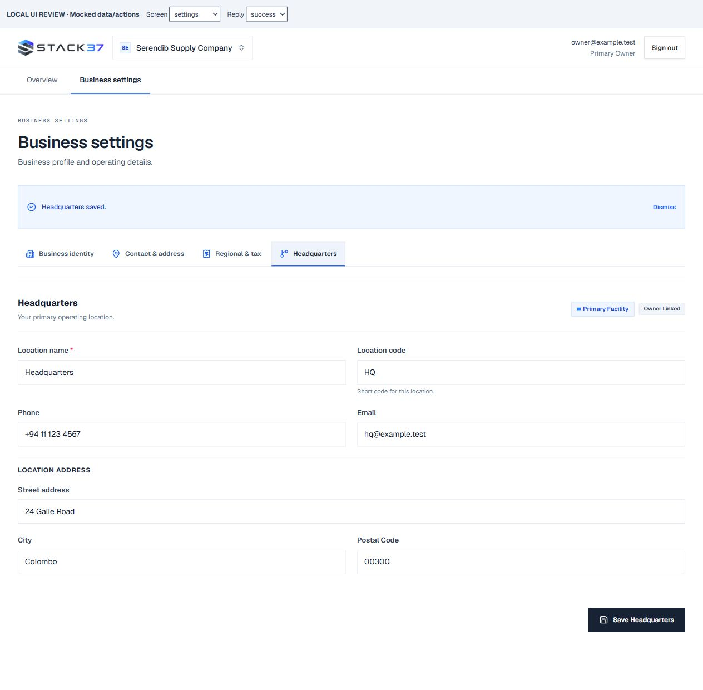

# TASK-STAB-005 — Approved Backend Corrections Integration

**Date:** October 14, 2026 (Asia/Colombo)\
**Correction integration:** READY_FOR_REVIEW — INTEGRATED_LOCAL\
**Overall TASK-STAB-005:** IN_PROGRESS; earlier local integration acceptance retained. Real database, RLS, rollback and authentication verification is DEFERRED / NOT EXECUTED.

## What was combined

The CEO authorized importing Antigravity's two TASK-STAB-005C corrections and their supporting tests into `codex/task-stab-005-integration`. Five files were imported byte-for-byte from a verified source snapshot:

| File | Integrated behavior |
|---|---|
| `src/lib/auth/business-config.ts` | Permission resolution defaults to readonly. The supplied membership must match the requested organization, be active and be Primary Owner. |
| `src/lib/actions/organization.ts` | Missing/erroring public Standard trial plan returns an explicit failure before provisioning; the price-sorted alternative-plan fallback is removed. |
| `tests/unit/backend-security-safeguards.test.ts` | Retains the original 19 cases/assertions; adds four owner/readonly permission cases and updates a chained-query mock. Now 23 cases. |
| `tests/unit/business-configuration.test.ts` | Existing owner fixtures include organization identity and active status; membership mocks support chained filters. Existing assertions retained. |
| `tests/unit/organization-actions.test.ts` | Expected missing-plan message follows the approved action contract; adds missing-Standard/no-alternative-plan coverage and retains no-provisioning assertions. |

Root targets had no competing changes relative to the baseline, except the already integrated safeguard suite. Its diff was reviewed and all original case names and assertion text were checked for preservation before import. Root `package.json` retains the `.worktrees/**` exclusion. Shared task/state records were updated selectively; Antigravity's older governance files were not copied over the accepted UI history. The revised verification proposal and prepared database-security test remain separate in its worktree.

No frontend code, logo, typography, horizontal navigation, authentication code, settings write action, proxy, migration or schema changed. Resolver/action signatures and result shapes remain compatible with the existing forms. The registration form displays action errors and does not present successful registration on failure; the Settings form uses `canEdit` to disable fields and hide save controls.

## Verification

| Check | Combined result |
|---|---|
| `npm run test:unit` | PASS — **194 tests / 13 files**. Antigravity's reported 190 tests plus the four accepted frontend tests. Only root unit paths discovered. |
| `npm run typecheck` | PASS — exit 0 |
| `npm run lint` | PASS — exit 0, no errors/warnings |
| Registration action tests | Missing Standard stops before RPC; existing available-Standard provisioning/result tests pass. |
| Settings resolver/write tests | Omitted/foreign membership, suspended/non-owner and valid owner cases pass; existing Business Settings and Headquarters action tests pass. |
| Isolated browser fixture | Registration error, retry and success presentation; readonly business/Headquarters fields and absent save controls; owner business save and Headquarters success feedback verified. **Mocked actions/data only.** |
| Preservation and Git validation | PASS — `git diff --check`; all five imported files match source snapshot; 69 other pre-existing root files and all 12 Antigravity source files unchanged; both new snapshots and both original snapshots pass manifest/file hash checks. |

The existing UI fixture at `127.0.0.1:3002` was reused after a sandbox launch failed and the authorized retry found that port already occupied by the existing fixture. No server or live service was stopped. This is a tooling/environment issue, not an application regression. The fixture imports mocked actions, so these interactions do not contact Supabase. Its generic error response verifies the error-display path; unit tests verify the exact new Standard-plan error.

No regressions were found in the executed checks. A production build was not rerun for this assignment; the earlier accepted successful build remains historical evidence.

An additional diff check with a temporary `core.autocrlf=false` override flagged existing CRLF lines as trailing whitespace. The standard repository `git diff --check` passed before and after that check (26 LF/CRLF conversion notices). No Git configuration or file line endings were changed to suppress it.

## Recovery and preservation

Both branches still share baseline `d17ed63a48e2313df0f5406d9074f9076b788721`:

- Main: `codex/task-stab-005-integration`, accepted frontend and integrated corrections remain uncommitted.
- Isolated backend: `task-stab-005b`, read only throughout this integration.

Before edits, separate snapshots copied each worktree's current changed/untracked project files and all five target files, checking source/copy SHA-256 equality:

`C:\Users\nimth\AppData\Local\Temp\STACK37-EOS-TASK-STAB-005C-integration-245d5701f6404d11a1b850f76b58a708`

| Snapshot | Files | Manifest SHA-256 |
|---|---:|---|
| `Codex-before-005C` | 76 | `651ED552BB0FCF128966EE57C8774859006C572892ED4C04F5D9C281069597BA` |
| `Antigravity-005C` | 12 | `4D0E1A6E9DDA923D28D69F64BB721772187BA9E998B7B79E3815F30413F8BCF2` |

Manifest JSON files identify source roots, baseline, branch, Git status and every file/hash. To recover, first preserve any newer work, verify the applicable manifest and selected snapshot hashes, then restore only reviewed affected files from `Codex-before-005C` to recover the pre-correction state or `Antigravity-005C` to recover this correction source. Do not reset or delete a worktree. This is recovery guidance, not an executed restoration.

The earlier 68-file TASK-STAB-004 and 7-file TASK-STAB-005B snapshots, hashes and reports remain at their original location recorded in `INTEGRATION-REPORT.md`. That report is historical accepted evidence and was not rewritten by this correction integration.

Final hash verification passed for the new 76/12-file snapshots and the original 68/7-file snapshots, including their recorded manifest hashes. All 69 root checkpoint files outside the five approved targets and the two updated task/state documents remained byte-identical. Every file in Antigravity's 12-file source checkpoint remained unchanged in its worktree. Final Git inspection confirmed both branch names and the shared baseline above. Only the five imported files, two task/state documents, this new report and its screenshot were changed or added by this assignment.

## Remaining gates and readiness

- **DEFERRED / NOT EXECUTED (BLOCKED) — PostgreSQL RLS isolation and authorization:** The resolver correction binds membership identity/organization/status/ownership but does not add an independent `user_id` predicate or session lookup. The current Settings route supplies membership from its authenticated tenant guard and write actions independently enforce ownership. Real caller binding and RLS enforcement still require verification; broader proposal changes are not included.
- **DEFERRED / NOT EXECUTED (BLOCKED) — provisioning transactions and constraints:** No real rollback, partial-record, duplicate slug/HQ or audit persistence test was executed.
- **DEFERRED / NOT EXECUTED (BLOCKED) — authentication/customer workflows:** No real confirmation/recovery email, GoTrue session/cookie, cross-subdomain organization switching or persisted Settings test was executed.
- **Subscription verification pending:** Required Standard resolution is corrected and passes mocks; actual configured plan, seven-day trial persistence, displayed status, entitlements and expiry are not proven by these checks.

The combined application is ready for preparation of the final verification stage. Overall acceptance still requires an authorized isolated database/authentication environment, appropriate fixture safeguards, and actual execution of the blocked tests. The revised verification plan remains a separate pending proposal; source-reported infrastructure readiness is not treated as test execution evidence.

No commit, push, merge, rebase, deployment, live database change, migration or worktree deletion occurred. Stop for CEO review and further authorization.

## Mocked browser evidence

